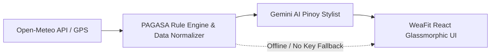

# ☀️ WeaFit
### Smart Weather Outfit & Activity Advisor tailored for the Philippines 🇵🇭

[](https://react.dev/)
[](https://www.typescriptlang.org/)
[](https://vitejs.dev/)
[](https://open-meteo.com/)
[](https://www.pagasa.dost.gov.ph/)
[](https://ai.google.dev/)

**WeaFit** is an intelligent tropical climate outfit and lifestyle recommendation system designed specifically for Filipino commuters, students, and professionals. Unlike Western weather apps that suggest winter coats or thermal scarves, WeaFit evaluates **PAGASA Heat Index (Damang Init)**, tropical monsoon rainfall warnings, UV radiation, and real commuter pain points (Jeepney heat, LRT rush hours, motorcycle ride sprays, and flooded sidewalks).

---

## 🌟 Key Features

### 1. 🌦️ Real-Time Weather via Open-Meteo API
* **No API Key Required for Weather:** Fetches live temperature, apparent temperature (Damang Init), precipitation probability, WMO condition codes, humidity, wind speed, and UV index.
* **Philippine Presets:** Instant 1-click weather for **Caloocan / Metro Manila, Quezon City, Baguio City, Tagaytay, Cebu City, and Davao City**.
* **GPS Geolocation:** 📍 Click *"Lokasyon Ko (GPS)"* for pinpoint precision anywhere in the Philippine archipelago.

### 2. 🌡️ Official DOST-PAGASA Heat Index & Rainfall Engine
Implements the exact **PAGASA Heat Index Classification Scale**:
* `< 27°C`: **Komportable / Presko** (Safe for outdoor activities)
* `27°C – 32°C`: **Mag-ingat (Caution)** (Fatigue possible with prolonged exposure)
* `33°C – 41°C`: **Labis na Pag-iingat (Extreme Caution)** (Heat cramps & heat exhaustion possible)
* `42°C – 51°C`: **PANGANIB (Danger)** (Heat exhaustion likely; heat stroke probable)
* `>= 52°C`: **MATINDING PANGANIB (Extreme Danger)** (Heat stroke is imminent; stay indoors!)

Includes PAGASA Rainfall Advisories (**Yellow**, **Orange**, and **Red Warnings**) to alert users about localized flash floods and transit bottlenecks.

### 3. 🛵 User Persona Context Filter
Recommendations dynamically adapt based on who you are:
* **Commuter PH:** Focused on Angkas shoe covers, foldable UV umbrellas, and portable fan/pamaypay.
* **Estudyante:** Campus walking fits, backpack rain covers, and layer combos for aircon vs. non-aircon rooms.
* **Corporate / Office:** Wrinkle-free breathable shirts with commuter-to-boardroom layer transitions.
* **Gala / Coffee Hop:** Trendy, photogenic, and climate-adaptive streetwear.
* **Athlete / Workout:** Safe morning/sunset running windows and hydration tracking.

### 4. 🤖 Google Gemini AI Smart Stylist (Structured JSON)
* Uses `responseSchema` to guarantee strict JSON typing (`vibeSummary`, `outfitItems`, `activities`, `commuterTip`).
* Speaks in modern, relatable **Taglish** like a real Pinoy stylist.
* **Hybrid Fallback:** Works 100% offline out-of-the-box using the built-in PAGASA Rule Engine if no API key is provided, or seamlessly switches to live Gemini 2.5 Flash when an API key is entered.

### 5. ⚡ Weather Simulator
Quickly test edge-case climate scenarios with one click:
* 🔥 **44°C Danger Heatwave** (NCR Tanghaling Tapat)
* 🌧️ **92% Tropical Storm / Habagat Warning**
* 🌲 **17°C Preskong Umaga sa Baguio**
* 🌊 **30°C Maaliwalas sa Cebu**
* ⚡ **Biglaang Thunderstorm sa Hapon**

### 6. 💻 Built-in Next.js Code Inspector
Click the **"Tingnan ang Next.js Code"** tab in the header to view and copy-paste ready-to-use production snippets:
* `app/api/weather-ai/route.ts` (Next.js App Router API Route)
* `lib/pagasaRules.ts` (PAGASA TypeScript Rule Engine)
* `.env.local` configuration guide

---

## 🏗️ 3-Step Architecture



---

## 🚀 Getting Started

### Prerequisites
* **Node.js** (v18 or newer recommended)
* **npm** or **pnpm**

### Installation

1. Clone the repository:
   ```bash
   git clone https://github.com/marwinnn03/WeaFit.git
   cd WeaFit
   ```

2. Install dependencies:
   ```bash
   npm install
   ```

3. Start development server:
   ```bash
   npm run dev
   ```

4. Open your browser at `http://localhost:5173`.

---

## 📁 Project Structure

```
WeaFit/
├── index.html                   # HTML entry point with Google Fonts
├── src/
│   ├── main.tsx                 # React DOM root
│   ├── App.tsx                  # Main app container & reactive theme
│   ├── index.css                # Glassmorphism design system & animations
│   ├── types/
│   │   └── index.ts             # TypeScript definitions
│   ├── data/
│   │   ├── cities.ts            # Philippine preset cities with GPS coordinates
│   │   └── codeSnippets.ts      # Next.js code inspector data
│   ├── utils/
│   │   ├── pagasaEngine.ts      # DOST-PAGASA Heat Index & Rainfall logic
│   │   ├── wardrobePresets.ts   # Localized wardrobe rules & persona mapping
│   │   ├── weatherService.ts    # Open-Meteo API fetcher & simulator
│   │   └── geminiService.ts     # Gemini API client with JSON schema
│   └── components/
│       ├── Header.tsx           # App header & control modals
│       ├── CitySelector.tsx     # Philippine cities pills & GPS locator
│       ├── PersonaSelector.tsx  # Commuter/Student/Office/Gala/Workout filter
│       ├── WeatherOverviewCard.tsx # Heat Index gauge & weather metrics
│       ├── PagasaAlertBanner.tsx# PAGASA danger alerts & health advisories
│       ├── OutfitRecommendationCard.tsx # Head-to-toe recommendations & closet checklist
│       ├── ActivityPlannerCard.tsx      # Do's, don'ts & commuter tips
│       ├── HourlyForecastSection.tsx    # 8-hour timeline forecast
│       ├── CommuterChecklistCard.tsx    # Bag packing checklist & hydration tracker
│       ├── WeatherSimulatorModal.tsx    # Instant weather scenario testing
│       ├── NextJsCodeInspectorModal.tsx # Full Next.js code inspector
│       └── GeminiKeyModal.tsx           # Gemini API key setup modal
└── README.md
```

---

## 📄 License
MIT License. Created with ❤️ for Filipino commuters and students.
Special thanks to **DOST-PAGASA** and **Open-Meteo**.
